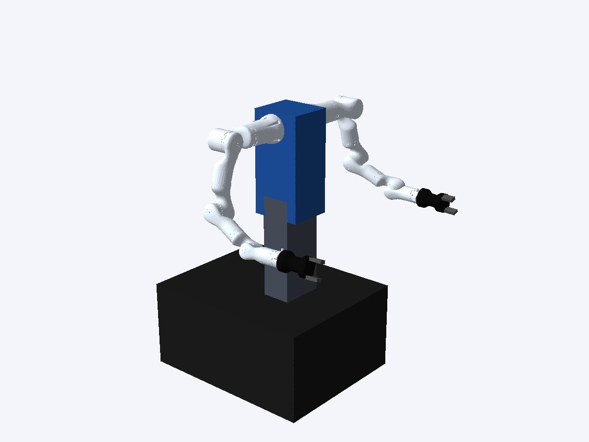

# 15 自由度移动双臂运动学仿真

**左臂 7 轴＋右臂 7 轴＋1 个腰部 pitch 关节，共 15 自由度。直接使用 Python 运行，不需要 ROS、Gazebo 或机器人。**
车轮和夹爪开合不计入这 15 个关节。默认双臂使用 **睿尔曼 RM75-B 标准版**的官方运动链、关节限位和连杆外形。
用户已确认 RM75 系列；具体末端版本、左右安装零位、腰部轴线/限位与夹爪 TCP 仍需按实机标定。



图示为本仓库模型的实际离屏渲染：手臂使用厂家 STL 外形，底盘、腰部和躯干仍使用简化几何。
模型文件随仓库提供，运行时不需要联网下载，也不需要厂家 SDK。

## 运行

完成[安装指南](INSTALL.zh-CN.md)后，在仓库根目录激活 `.venv`：

```bash
# 桌面三维动画：底盘保持固定，腰部与两只七轴臂一起运动
python -m community.mobile_dual_pitch

# 无窗口计算并检查运动路径
python -m community.mobile_dual_pitch --headless

# 调整腰部目标角度，导出离线运动学采样点
python -m community.mobile_dual_pitch --headless --pitch-rad 0.15 \
  --plan-output community-results/kinematics-15dof-playback.json
```

输出 `joints: 15`、`arm_dof: [7, 7]`、`arm_models: ["RM75-B", "RM75-B"]`、`ros_required: false`、`status: passed`
表示默认 RM75-B 离线路径通过采样碰撞检查。
桌面模式播放经过检查的关节路径；鼠标交互沿用 WRS 查看器。没有图形桌面时使用 `--headless`。
默认示例的两个第七轴均有实际转动，并影响末端姿态。

## 直接调用运动学模型

```python
from community.pitch_robot import MobileDualPitch

robot = MobileDualPitch()
q = robot.get_jnt_values('waist_and_arms')  # 15 个角度，单位 rad
q[0] = 0.10       # 腰部 pitch
q[7] = 0.20       # 左臂第 7 轴
q[14] = -0.20     # 右臂第 7 轴
robot.fk('waist_and_arms', q)
print(robot.get_gl_tcp('lft_arm'))  # 左夹爪 TCP 位置、旋转矩阵
print(robot.get_gl_tcp('rgt_arm'))
print('碰撞：', robot.is_collided())
```

| 组件 | 关节数 | 顺序 |
|---|---:|---|
| `waist_and_arms` | 15 | 腰 → 左臂 1–7 → 右臂 1–7 |
| `both_arm` | 14 | 左臂 1–7 → 右臂 1–7 |
| `lft_arm` / `rgt_arm` | 7 | 单臂从肩部到腕部 |

`fk`、`get_jnt_values`、`get_jnt_ranges`、`rand_conf` 均按组件处理真实维度；错误长度、非有限值和越限输入会在修改姿态前被拒绝。
`robot.ik('lft_arm', target_position, target_rotation, seed_jnt_values=...)` 可在腰部固定时求七轴单臂逆解。
关节路径可通过 `community.common.plan_path(robot, robot.component, start, goal)` 调用原有 RRT-Connect 规划器。
暂未提供双末端目标的十五关节联合逆解器。

统一任务 API 的 `client.run_demo('mobile_dual_pitch')` 也运行该十五关节示例。
`plan_joint_motion` 仍专门服务六轴 UR3e 裸臂规划；十五关节自定义规划使用上面的模型接口。

## 配置与坐标

采用 x 向前、y 向左、z 向上的坐标约定。腰部绕底盘 **+Y 轴**按右手方向旋转，单位 rad。
转轴位置以底盘坐标系表示；腰部带动躯干、双臂、夹爪和所持物体，底盘不随腰部俯仰。

| 配置文件 | 关键参数 |
|---|---|
| [dual-rm75.reference.json](../configs/simulation/dual-rm75.reference.json) | 默认：RM75-B 型号、左右安装位置与 RPY、各臂初始角度 |
| [rm75-waist.reference.json](../configs/simulation/rm75-waist.reference.json) | 默认：紧凑底盘、腰部转轴和限位、躯干参考碰撞盒 |
| [RM75-B.urdf](../community/models/realman_rm75/RM75-B.urdf) | 厂家原文件：七个关节的固定变换、轴线、位置限位与模型路径 |
| [dual-seven-axis.reference.json](../configs/simulation/dual-seven-axis.reference.json) | 可选通用七轴盒状模型，供无具体机型时使用 |
| [mobile-dual-pitch.reference.json](../configs/simulation/mobile-dual-pitch.reference.json) | 通用七轴/旧模型使用的原始腰部配置 |

```bash
python -m community.mobile_dual_pitch --arm-config 我的双臂参数.json \
  --waist-config 我的腰部参数.json --headless
```

RM75 适配器逐个读取 URDF 的关节原点平移、固定 RPY、旋转轴与角度限位，包含七轴之间的固定坐标变换。
URDF 只是 XML 模型文件，读取它不依赖 ROS。保留原始 rad 限位，未把不同关节统一设为同一范围。

| 关节 | 官方说明书范围（°） | 当前 URDF 范围（rad） |
|---|---:|---:|
| J1 / J3 / J5 | ±178 | ±3.106 |
| J2 | ±130 | ±2.2689 |
| J4 | ±135 | ±2.356 |
| J6 | ±128 | ±2.234 |
| J7 | ±360 | ±6.28 |

官方 RM75-B 改进 D-H 的非零 d 参数为 240.5、256、210、144 mm。
全零位从安装底面到法兰的轴向距离为 850.5 mm；产品标称工作半径 610 mm 不应直接当成这段距离。
官方 URDF 的 ±π/2 固定角使用 ±1.5708，因此和精确 D-H 计算存在微小舍入差。
来源和资产许可证见[RM75 模型说明](../community/models/realman_rm75/NOTICE.md)。

默认左右臂安装底面法向朝身体两侧，安装高度约 1.06 m、安装底面间距约 0.20 m、腰轴高度约 0.66 m，
用于复现总装的结构和比例。这些取整参考值、安装法兰绕轴零位、腰部 ±0.35 rad 范围均未完成实机标定。
夹爪继续使用 RobotiqHE 参考模型，其开合不占十五关节维度，TCP 也不代表实机夹爪标定值。

当前只启用 RM75-B 标准版。六维力版和其他末端版本不能直接沿用同一法兰偏置；
配置填写未支持的 `model` 时会明确报错。现场确认版本后再换对应模型。

仍可显式运行原通用链：

```bash
python -m community.mobile_dual_pitch --headless \
  --arm-config configs/simulation/dual-seven-axis.reference.json
```

碰撞检查覆盖两臂固定底座和所有七段连杆、参考夹爪、躯干、底盘与外部障碍物。
RM75 连杆使用由 STL 生成的局部包围盒并外扩 1 mm，属于保守近似，不是精确网格接触计算。
相邻连杆不作自碰撞配对；固定底座与同一肩机构的 J1/J2、底座与连接它的躯干/支架也不配对。
其余同臂非相邻连杆、两臂之间及身体与运动臂段参与检查。夹持物体为几何附着，没有接触力学。
路径检查的最大关节采样间隔为 0.025 rad，不是连续碰撞证明。

## 离线导出与旧示例

导出文件 schema 为 `omindos.community.kinematics.dual7_pitch.v1`，包含 `simulation_only: true`、
十五个 `joint_names`、`positions_rad`、双臂与腰部参考配置、底盘位姿。
这些是无执行时序的运动学采样点，不是 ROS2 消息或电机控制轨迹。

原有 UR3e 单臂、十二关节双臂示例保持原样。原十三关节带腰参考模型改用显式入口：

```bash
python -m community.legacy_mobile_dual_pitch --headless
```

旧 ROS2 通信示例仍只服务原十二／十三关节协议；十五关节仿真不导入 `rclpy`，也不依赖 ROS 环境。
需要原十三关节 ROS2 测试文件时，按 [ROS2 接口说明](ROS2_INTERFACE.md)运行旧入口。

## 验证

```bash
python -m unittest community.test_dual7 community.test_rm75
python -m community.verify
```

RM75 回归以官方改进 D-H 表独立交叉计算双臂 40 个随机姿态，含底盘旋转、腰部俯仰和左右安装旋转。
新增回归覆盖模型资产校验、正运动学、每个关节对末端的作用、七轴逆解、十五维规划、
第七连杆与身体障碍物、双臂互撞及自碰撞、夹持物体随腰部和第七轴运动、维度与限位拒绝、模型复制。

当前不模拟重力、力矩、底盘动力学或夹持接触，不会驱动真机。
已确认型号及尚待核对的末端版本、零位和驱动资料记录在[硬件参数模板](../configs/hardware/mobile-dual-7dof-pitch.template.json)中。
